# Smart Shisha LED – Bauanleitung

Stand 2026-11-14 · Teile T1 v6, T2 v3, T4 v1 · Firmware ab 0.3.1

Die Bilder sind aus den STL-Dateien gerendert, die Elektronik ist als vereinfachte Quader dargestellt. Neu erzeugen mit `python3 tools/gen_bauanleitung_bilder.py`. Alle Maße und Schraubenlängen sind aus dem CAD berechnet; was noch nicht am Gerät geprüft ist, steht unter [Annahmen](#annahmen).

## Auf einen Blick

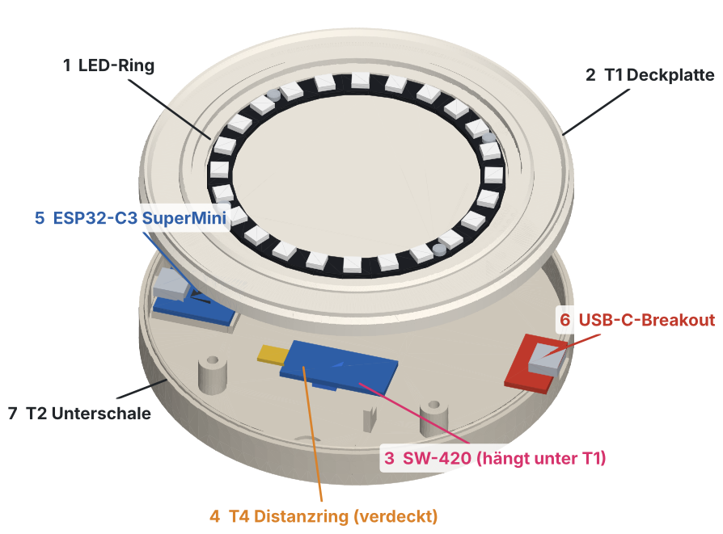

| Nr. | Bauteil | Sitzt wo | Ausrichtung | Befestigt mit | Schritt |
|---|---|---|---|---|---|
| 1 | LED-Ring | T1 oben, in der runden Einfassung | LEDs nach oben, Lötpads über der rechteckigen Kabelaussparung | 4 × Schraube M2 × 6 in 4 × Einschmelzmutter M2 (in T1) | [3](#3-led-ring-an-t1) |
| 2 | T1 Deckplatte | auf T2 | Sensor landet zwischen den zwei Sensorstiften von T2 | 4 × Schraube M3 × 12 von unten durch T2 in 4 × Einschmelzmutter M3 (in T1) | [9](#9-gehäuse-schließen) |
| 3 | SW-420 | unter T1, am Rand gegenüber der Kabelaussparung | Bauteile nach unten, Stiftleiste zur SuperMini-Seite | 1 × Schraube M3 × 6 durch Sensor und T4 in 1 × Einschmelzmutter M3 (in T1) | [4](#4-sensor-an-t1) |
| 4 | T4 Distanzring | zwischen SW-420 und T1 | – | von der Sensorschraube mitgehalten | [4](#4-sensor-an-t1) |
| 5 | ESP32-C3 SuperMini | T2, Rahmen an der Wand mit der kleinen Programmier-Öffnung | Bauteilseite oben, USB-Buchse zur Wand | **keine Schraube**: Schnappzunge im Rahmen | [7](#7-supermini-und-breakout-in-t2-einbauen) |
| 6 | USB-C-Breakout | T2, gegenüber dem SuperMini | Buchse oben, zeigt durch die Wandöffnung nach außen | 2 × Blechschraube 2,5 × 4 **direkt in die zwei Sockel** von T2, keine Mutter | [7](#7-supermini-und-breakout-in-t2-einbauen) |
| 7 | T2 Unterschale | unten | – | 4 × Silikonfuß Ø 10, selbstklebend, in die runden Mulden | [10](#10-füße) |
| – | Elko | Hohlraum, direkt unter der Kabelaussparung | Minus-Streifen an GND | an die 5V- und GND-Litze des Rings gelötet | [3](#3-led-ring-an-t1) |

**In T2 kommt keine einzige Einschmelzmutter.** Alle Muttern sitzen in T1.

### Alle Schrauben und Muttern

| Teil | Anzahl | Wo genau | Von welcher Seite | Schritt |
|---|---|---|---|---|
| Einschmelzmutter M2, Außen-Ø ca. 3,5, Länge 3 mm (höchstens 4) | 4 | T1, die vier kleinen Löcher in der Ring-Einfassung | von oben | [2](#2-einschmelzmuttern-in-t1) |
| Einschmelzmutter M3, Außen-Ø ca. 4,5, Länge 3–4 mm | 4 | T1 Unterseite, die vier Löcher in den Ecken | von unten | [2](#2-einschmelzmuttern-in-t1) |
| Einschmelzmutter M3, wie oben | 1 | T1 Unterseite, das einzelne Loch am Rand gegenüber der Kabelaussparung | von unten | [2](#2-einschmelzmuttern-in-t1) |
| Schraube M2 × 6 (M2 × 5 geht auch), Linsen- oder Zylinderkopf | 4 | LED-Ring → T1 | von oben | [3](#3-led-ring-an-t1) |
| Schraube M3 × 6, Zylinderkopf | 1 | SW-420 + T4 → T1. **Nicht länger:** M3 × 8 stößt im 4,5 mm tiefen Loch an, bevor sie klemmt | von unten | [4](#4-sensor-an-t1) |
| Blechschraube (selbstschneidend) 2,5 × 4 oder M2,5 × 4 | 2 | USB-C-Breakout → Sockel in T2. **Nicht länger als 4 mm:** Das Loch im Sockel ist nur 2,7 mm tief, darunter bleiben 0,8 mm Boden | von oben | [7](#7-supermini-und-breakout-in-t2-einbauen) |
| Schraube M3 × 12, Zylinderkopf (Kopf-Ø höchstens 6 mm, z. B. DIN 912) | 4 | T2 → T1, durch die vier Schraubdome | von unten, Kopf versenkt | [9](#9-gehäuse-schließen) |
| Silikonfuß Ø 10 mm, selbstklebend | 4 | T2 Unterseite, runde Mulden | – | [10](#10-füße) |

## 1. Vorbereiten

### Druckteile

| Teil | Datei | Lage auf dem Bett |
|---|---|---|
| T1 Deckplatte | `cad/v6/stl/T1_Deckplatte_v6.stl` | Glasauflage nach oben |
| T2 Unterschale | `cad/v3/stl/T2_Unterschale_v3.stl` | Boden auf dem Bett |
| T4 Distanzring | `cad/v1/stl/T4_Distanzring_v1.stl` | flach |

PETG oder PLA, ohne Stützmaterial. Druckeinstellungen: [`planung/03_mechanical_design.md`](planung/03_mechanical_design.md), Abschnitt 13.

### Elektronik und Material

| Anzahl | Teil |
|---|---|
| 1 | ESP32-C3 SuperMini, **ohne** Stiftleisten (sind welche angelötet: auslöten, sonst passt er nicht) |
| 1 | LED-Ring 24 × WS2812, Ø 86 mm |
| 1 | SW-420-Vibrationssensor-Modul |
| 1 | USB-C-Breakout (rotes Modul, 5,1 kΩ an CC) |
| 1 | Elko 470–1000 µF, ≥ 6,3 V, höchstens Ø 8 mm |
| ca. 1,2 m | Litze 0,14–0,25 mm² in Rot, Schwarz, Orange, Grün, Blau |
| ca. 20 cm | Schrumpfschlauch Ø 1,5–2 mm |
| | Heißkleber oder Silikon |

### Werkzeug

Lötkolben (für die Muttern am besten mit Einschmelzspitze), Lötzinn, Seitenschneider, Abisolierzange, Innensechskant- bzw. Kreuzschlitz-Schraubendreher passend zu den Schrauben, kleiner Schlitzschraubendreher (Poti), Messer zum Entgraten, Multimeter.

### Druckteile prüfen

1. Den Elefantenfuß (die nach außen gequetschte erste Schicht) an der Feder oben auf der T2-Wand und an der Nut unten in T1 mit dem Messer entgraten.
2. T1 trocken auf T2 setzen und wieder abnehmen. Das muss ohne Kraft gehen.
3. T4 auf eine M3-Schraube stecken: Sie muss locker durchgehen.

## 2. Einschmelzmuttern in T1

**Du brauchst:** T1, 4 × Einschmelzmutter M2, 5 × Einschmelzmutter M3, Lötkolben.

**So setzt du eine Mutter:** Lötkolben auf ca. 220–230 °C bei PETG bzw. ca. 200 °C bei PLA. Mutter mit der schmalen Seite in das Loch stellen, Lötkolbenspitze hineinstecken und die Mutter **nur mit dem Gewicht des Kolbens** senkrecht einsinken lassen (ca. 5–10 s). Kurz bevor sie bündig ist, Kolben gerade herausziehen und die Mutter sofort mit einer flachen Metallfläche (z. B. dem Schaft eines Schraubendrehers) bündig drücken, bis der Kunststoff fest ist (ca. 10 s).

### 2a. Oben: 4 × M2 in die Ring-Einfassung

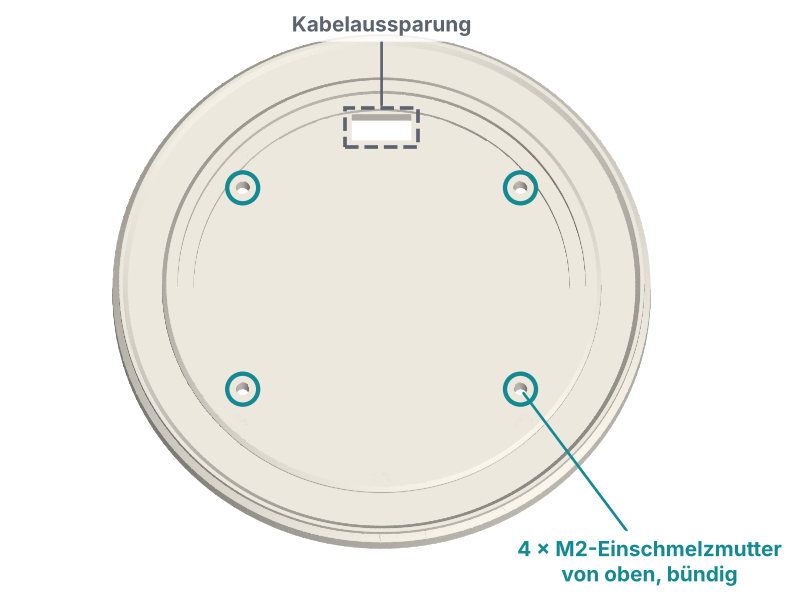

1. T1 mit der Glasauflage nach oben auf den Tisch legen.
2. In jedes der vier kleinen Löcher in der runden Einfassung eine M2-Mutter **von oben** setzen.
3. Jede Mutter muss **bündig mit dem Boden der Einfassung** abschließen. Steht eine über, liegt der Ring schief und drückt das Glas.

### 2b. Unten: 4 × M3 für das Gehäuse und 1 × M3 für den Sensor

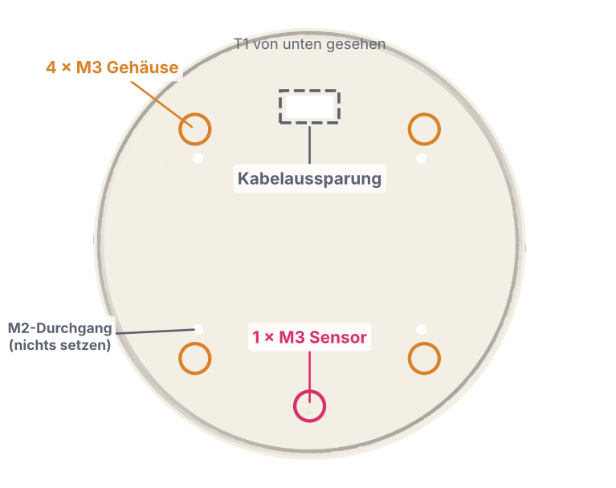

1. T1 umdrehen.
2. **Vier M3-Muttern** in die vier großen Löcher in den Ecken (orange markiert). Hier wird später T2 angeschraubt.
3. **Eine M3-Mutter** in das einzelne große Loch am Rand gegenüber der Kabelaussparung (rot markiert). Hier wird der Sensor angeschraubt.
4. Die vier kleinen Löcher neben den Ecklöchern sind die Rückseite der M2-Muttern aus 2a. Dort kommt von unten nichts hinein.

**Check:** Alle neun Muttern sitzen senkrecht und bündig. Eine M2- bzw. M3-Schraube lässt sich in jede Mutter von Hand einige Umdrehungen eindrehen.

## 3. LED-Ring an T1

**Du brauchst:** T1 mit Muttern, LED-Ring, 4 × Schraube M2 × 6, Elko, Litzen R1–R3 (Tabelle unten), Heißkleber.

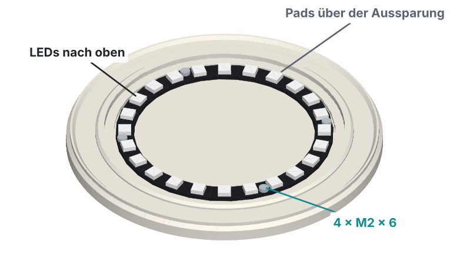

1. Litzen nach der Tabelle in [Schritt 5](#5-litzen-zuschneiden-und-verlöten) zuschneiden (R1–R3, je 15 cm) und an die Pads auf der **Rückseite** des Rings löten: **5V** rot, **GND** schwarz, **DI** grün. **DO** bleibt frei. Die Litzen flach vom Ring weg zur Ringmitte hin führen, damit nichts aufträgt.
2. Die drei Litzen von oben durch die rechteckige **Kabelaussparung** in T1 stecken.
3. Den Ring mit den **LEDs nach oben** in die Einfassung legen. Die Lötpads liegen genau über der Aussparung, die vier Ringlöcher über den M2-Muttern.
4. Vier **Schrauben M2 × 6** von oben durch den Ring in die M2-Muttern drehen. Über Kreuz anziehen, nur handfest: Die Platine darf sich nicht biegen.
5. **Elko anlöten:** T1 umdrehen. An der roten (5V) und der schwarzen (GND) Ringlitze etwa 3 cm unterhalb der Aussparung je 5 mm Isolierung entfernen (Abisolierzange mittig ansetzen und die Isolierung auseinanderschieben). Den Elko mit möglichst kurzen Beinen daran löten: **Minus (Streifen auf dem Gehäuse) an Schwarz**, Plus an Rot. Beide Lötstellen mit Schrumpfschlauch oder Isolierband abdecken.
6. Die Aussparung von unten mit Heißkleber oder Silikon verschließen. Das hält die Litzen und hält Feuchtigkeit vom Ring fern.

**Check:** Der Ring liegt rundum plan in der Einfassung. Kein Schraubenkopf steht höher als die LEDs.

## 4. Sensor an T1

**Du brauchst:** T1 mit Ring, SW-420, T4, 1 × Schraube M3 × 6, Litzen S1–S3 (Tabelle unten).

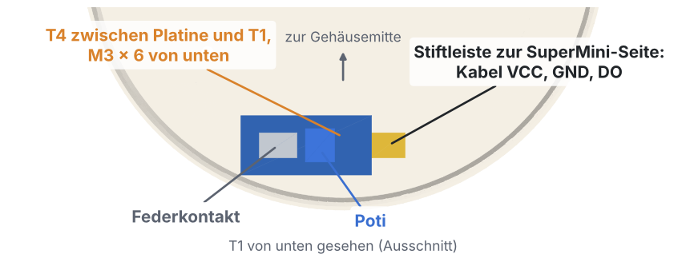

1. Litzen S1–S3 (je 12 cm) an die Stifte des SW-420 löten: **VCC** orange, **GND** schwarz, **DO** blau. Die gewinkelten Stifte dürfen dranbleiben; Lötstellen mit Schrumpfschlauch isolieren.
2. T1 umgedreht hinlegen (Unterseite oben, Kabelaussparung von dir weg).
3. Den Distanzring **T4** auf die einzelne M3-Mutter am Rand legen.
4. Den Sensor mit der **Bauteilseite nach oben** (Poti und Federkontakt zeigen zu dir; im fertigen Gerät zeigen sie nach unten) auf T4 legen, sein Loch über T4. Die Platine liegt **längs zum Rand**, die **Stiftleiste zeigt nach rechts**. Im fertigen Gerät ist das die Seite des SuperMini.
5. **Schraube M3 × 6** durch Sensor und T4 in die Mutter drehen, bis sich der Sensor nicht mehr von Hand verdrehen lässt.

**Check:** Der Sensor sitzt fest, berührt T1 nur über T4 und liegt parallel zum Rand.

## 5. Litzen zuschneiden und verlöten

Die Litzen werden **verlötet, bevor SuperMini und Breakout eingebaut werden**. So musst du nicht im Gehäuse löten. Lege dazu T1 (mit Ring und Sensor, Unterseite oben) und T2 nebeneinander, die Kabelaussparung von T1 zur T2-Seite mit dem SuperMini.

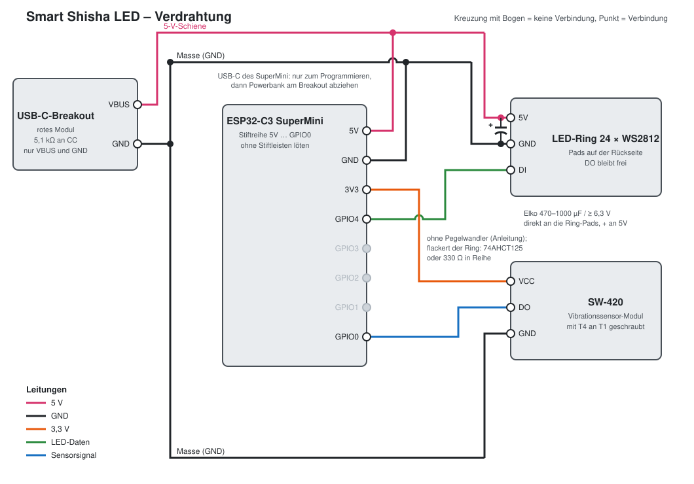

| Litze | Farbe | Länge | Von | Nach | Schritt |
|---|---|---|---|---|---|
| R1 | rot | 15 cm | LED-Ring 5V | Breakout VBUS | 3 / hier |
| R2 | schwarz | 15 cm | LED-Ring GND | Breakout GND | 3 / hier |
| R3 | grün | 15 cm | LED-Ring DI | SuperMini GPIO4 | 3 / hier |
| S1 | orange | 12 cm | SW-420 VCC | SuperMini 3V3 | 4 / hier |
| S2 | schwarz | 12 cm | SW-420 GND | SuperMini GND | 4 / hier |
| S3 | blau | 12 cm | SW-420 DO | SuperMini GPIO0 | 4 / hier |
| P1 | rot | 12 cm | Breakout VBUS | SuperMini 5V | hier |
| P2 | schwarz | 12 cm | Breakout GND | SuperMini GND | hier |

Danach kommen an diese Pads je zwei Litzen: **Breakout VBUS** (R1 + P1), **Breakout GND** (R2 + P2) und **SuperMini GND** (S2 + P2). Beide Litzenenden verdrillen, gemeinsam verzinnen und dann auflöten.

1. **Breakout:** P1 und P2 zuschneiden. R1 + P1 gemeinsam an **VBUS**, R2 + P2 gemeinsam an **GND** löten. Sonst nichts an das Breakout.
2. **SuperMini** (Pads mit der Bauteilseite nach oben, Reihe 5V – GND – 3V3 – GPIO4 – GPIO3 – GPIO2 – GPIO1 – GPIO0): P1 an **5V**, S2 + P2 an **GND**, S1 an **3V3**, R3 an **GPIO4**, S3 an **GPIO0**. GPIO1–3 bleiben frei. Die Litzen von oben anlöten und auf der Unterseite überstehende Enden bündig abknipsen: Unter der Platine sind nur 1,5 mm Luft.
3. Alle Lötstellen mit Schrumpfschlauch isolieren, wo zwei blanke Stellen sich berühren könnten.

**Check:** Mit dem Multimeter zwischen Breakout VBUS und GND messen: kein Kurzschluss (nicht 0 Ω). Und zwischen SuperMini 3V3 und GND: kein Kurzschluss.

## 6. Firmware und Funktionstest (Gehäuse noch offen)

Jetzt testen, solange noch alles zugänglich ist. T1 liegt dabei mit dem Ring nach oben neben T2, die Elektronik liegt lose daneben.

1. Firmware aufspielen: im Browser, siehe [flashen.md](flashen.md). Dafür den SuperMini per USB an den Computer, Powerbank **abziehen**.
2. Powerbank am Breakout anschließen. Das offene WLAN **ShishaLed** erscheint. Mit dem Handy verbinden und **http://192.168.4.1** öffnen.
3. **Ring:** Unter **Licht** Dauerlicht in Weiß einschalten. Alle 24 LEDs leuchten gleichmäßig.
4. **Sensor-Grundeinstellung:** Das Poti am SW-420 mit dem kleinen Schlitzschraubendreher so drehen, dass die grüne DO-LED auf dem Sensor in Ruhe gerade dauerhaft leuchtet und beim leichten Klopfen auf T1 flackert.
5. **Zugerkennung:** Unter **Mehr → Sensor** den Diagnosemodus einschalten. In Ruhe wird kein Zug erkannt, beim Klopfen auf T1 startet einer.
6. **Wärme:** Nach 15 Minuten ist der ESP-Chip warm, aber nicht heiß (Finger lässt sich drauflassen).
7. Powerbank abziehen.

## 7. SuperMini und Breakout in T2 einbauen

**Du brauchst:** T2, verlöteten SuperMini und Breakout, 2 × Blechschraube 2,5 × 4.

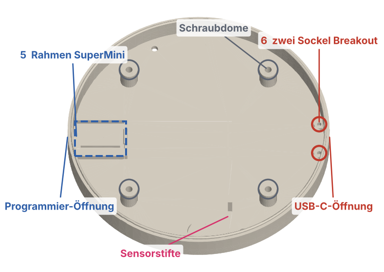

### 7a. SuperMini (Nr. 5)

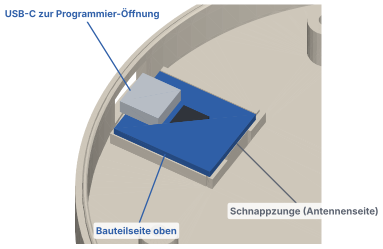

1. Den SuperMini mit der **Bauteilseite nach oben** halten, die USB-Buchse zeigt zur Wand mit der kleinen **Programmier-Öffnung**.
2. Zuerst die USB-Seite schräg in den Rahmen schieben, bis die Buchse in der Öffnung sitzt.
3. Dann die andere Seite (Antennenseite, zur Gehäusemitte) herunterdrücken, bis die **Schnappzunge** hörbar einrastet. Keine Schraube, kein Kleber.
4. Zum Ausbauen die Schnappzunge mit einem kleinen Schraubendreher zur Mitte drücken und die Platine an der Antennenseite anheben.

### 7b. USB-C-Breakout (Nr. 6)

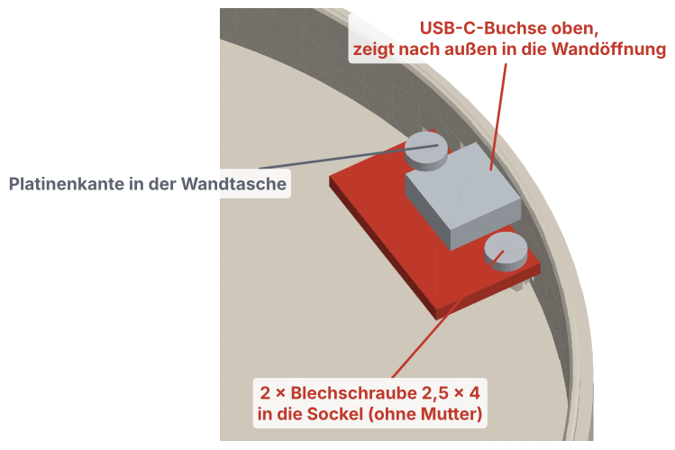

1. Das Breakout mit der **USB-C-Buchse nach oben** halten, die Buchse zeigt zur gegenüberliegenden Wand mit der **USB-C-Öffnung**.
2. Die Platinenkante an der Buchse in die schmale **Wandtasche** unter der Öffnung schieben, bis die Buchse von außen bündig in der Öffnung sitzt.
3. Die beiden Platinenlöcher liegen jetzt über den zwei runden **Sockeln** im Boden.
4. Zwei **Blechschrauben 2,5 × 4** von oben durch die Platinenlöcher in die Sockel drehen. Die Sockel haben nur ein Kernloch, die Schraube schneidet ihr Gewinde selbst. Langsam eindrehen und aufhören, sobald die Platine fest aufliegt; weiterdrehen reißt das Gewinde im Kunststoff aus.

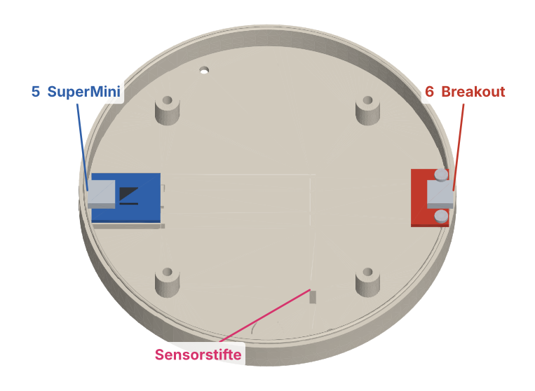

**Check:** Ein USB-C-Stecker lässt sich von außen in beide Buchsen ganz einstecken, ohne dass sich eine Platine bewegt.

## 8. Litzen verlegen

1. Die Litzen in einem Bogen um die Gehäusemitte legen, nicht über die vier Schraubdome und nicht über die zwei Sensorstifte.
2. Den Elko flach in die Nähe der Kabelaussparung legen, wo er nicht gequetscht wird.
3. Überlänge ist gewollt: Zum Service muss sich T1 umgedreht neben T2 legen lassen.

## 9. Gehäuse schließen

**Du brauchst:** T1 mit Ring und Sensor, T2 mit Elektronik, 4 × Schraube M3 × 12.

1. T1 umdrehen (Ring oben) und über T2 halten. Drehen, bis der **Sensor genau über den zwei Sensorstiften** von T2 steht. Die Stiftleiste des Sensors zeigt dann zur Seite des SuperMini.
2. T1 gerade absenken. Dabei keine Litze zwischen Feder und Nut oder auf einem Schraubdom einklemmen.
3. Feder in die Nut drücken, bis T1 rundum aufliegt. Klemmt es, wieder abheben und nach einer eingeklemmten Litze schauen.
4. Das Gehäuse vorsichtig umdrehen und vier **Schrauben M3 × 12** von unten durch die versenkten Löcher in T2 in die M3-Muttern von T1 drehen. Über Kreuz anziehen, handfest.

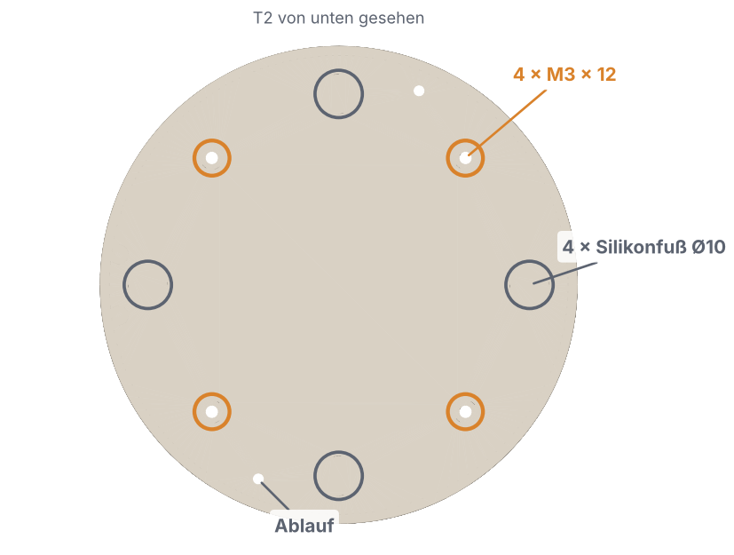

## 10. Füße

1. Die vier runden Mulden auf der Unterseite von T2 mit etwas Spiritus entfetten.
2. In jede Mulde einen **Silikonfuß Ø 10** kleben.

**Check:** Das Gerät steht plan und wackelt nicht. Das Glas steht ohne Kippeln im Zentrierrand. Ein Zug am Schlauch lässt den Ring reagieren.

Das Poti ist im geschlossenen Gehäuse nicht erreichbar. Für eine andere Empfindlichkeit die vier Schrauben lösen, T1 abheben und neben T2 legen.

## 11. Bedienung

1. Powerbank anschließen. Das Gerät öffnet das offene WLAN **ShishaLed**.
2. Mit dem Handy verbinden und **http://192.168.4.1** öffnen.
3. Die Web-App hat unten die Reiter **Start** (laufender Zug, Ring, Modus), **Licht** (Modus, Dauerlichtfarbe, Helligkeit, Bereitschaftsglimmen), **Spieler** (Name), **Rangliste** und **Mehr** mit **Farbverlauf** (Zeit bis Gelb/Rot), **Sensor** (Impulse, Nachlaufzeit, Diagnosemodus), **System** und **Hilfe**. Auf breiten Bildschirmen stehen alle Bereiche in einer Seitenleiste.
4. Alle Einstellungen, der Name und die Rangliste gehen beim Ausschalten verloren (bewusst, Lastenheft SYS-03). Nach dem Einschalten gelten die Standardwerte.

## 12. Fehlersuche

| Beobachtung | Ursache und Abhilfe |
|---|---|
| Dauerzug, obwohl niemand zieht | Firmware vor 2026-11-08 (falsche Sensorpolarität): aktuelle Firmware flashen. Sonst Poti unempfindlicher drehen. |
| Züge werden nicht erkannt | Poti empfindlicher drehen. Sensorschraube fest? S3 an GPIO0? |
| Ring flackert oder zeigt falsche Farben | Elko fehlt oder sitzt weit weg vom Ring, R2 prüfen. Hilft das nicht: 330 Ω in R3 oder Pegelwandler 74AHCT125 nachrüsten. |
| ESP-Chip wird heiß | Firmware ab 0.3.1 flashen. Wird stattdessen der kleine Regler neben der USB-Buchse heiß: Kurzschluss an 3V3 suchen. |
| WLAN bricht ab oder ist schwach | Handy näher als ca. 3 m. Kein Metall direkt über der Antennenseite des SuperMini. |
| Powerbank schaltet nach einiger Zeit ab | Im Leerlauf zieht das Gerät wenig Strom, manche Powerbanks halten das für „nichts angeschlossen“. Powerbank mit Kleinstrom- bzw. Dauerbetrieb-Modus verwenden (oft per Doppeldruck auf den Knopf). |
| T1 lässt sich nicht aufsetzen | Elefantenfuß an Feder oder Nut entgraten, eingeklemmte Litzen prüfen. |
| Breakout wackelt | Gewinde im Sockel ausgerissen: nächstgrößere Blechschraube (2,9 × 4) oder einen Tropfen Sekundenkleber ins Loch und neu eindrehen. |

## Annahmen

- Sensorpolarität am echten Aufbau geprüft (2026-11-08): SW-420 in Ruhe LOW (DO-LED an), bei Vibration HIGH, daher `SENSOR_ACTIVE_LOW = false`.
- Einschmelzmuttern: Bohrungen M2 Ø 3,2 durchgehend (4,4 mm) und M3 Ø 4,0, 4,5 mm tief (Coupon nicht getestet).
- Schraubenlängen aus dem CAD berechnet, Platinendicke von Sensor und Breakout mit 1,6 mm angenommen: M3 × 12 greift ca. 3 mm in die Mutter (höchstens M3 × 13), M3 × 6 am Sensor ca. 3 mm, Blechschraube 2,5 × 4 ca. 2,4 mm in den Sockel (höchstens 4,3 mm Länge).
- Glashalterung (Zentrierrand und Außenring) mit Testring v6 am echten Glas geprüft (2026-10-28).
- Glasabstand zu den LEDs rechnerisch ca. 1,1 mm.
- LED-Strom 20 mA je Kanal, Stromgrenze 500 mA.
- Breakout-Maße laut Datenblatt, nicht nachgemessen.
- Datenleitung ohne Pegelwandler.
- Litzenlängen geschätzt.
