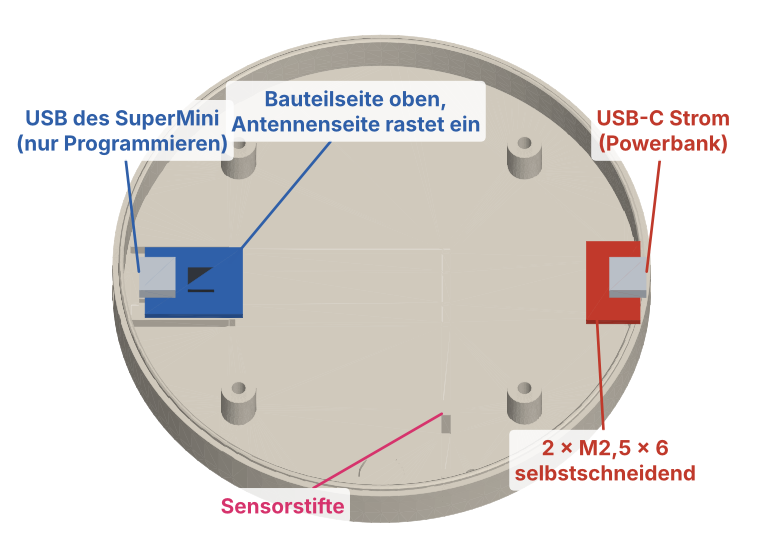

# Smart Shisha LED – Bauanleitung

Stand 2026-11-14 · Teile T1 v6, T2 v3, T4 v1 · Firmware ab 0.3.1

Die Bilder sind aus den STL-Dateien gerendert (Elektronik als vereinfachte Quader). Sie werden mit `python3 tools/gen_bauanleitung_bilder.py` neu erzeugt, wenn sich das CAD ändert. Werte, die noch nicht am Gerät geprüft sind, stehen unter [Annahmen](#annahmen).

**Prinzip:** T1 (Deckplatte) trägt oben den LED-Ring und unten den Sensor. T2 (Unterschale) trägt den SuperMini und das USB-C-Breakout. Zum Öffnen löst man vier Schrauben von unten und hebt T1 ab; Ring und Sensor bleiben an T1.

## 1. Teile und Werkzeug

### Druckteile

| Teil | Datei | Lage auf dem Bett |
|---|---|---|
| T1 Deckplatte | `cad/v6/stl/T1_Deckplatte_v6.stl` | Glasauflage nach oben |
| T2 Unterschale | `cad/v3/stl/T2_Unterschale_v3.stl` | Boden auf dem Bett |
| T4 Distanzring | `cad/v1/stl/T4_Distanzring_v1.stl` | flach |

PETG oder PLA, ohne Stützmaterial. Druckeinstellungen: [`planung/03_mechanical_design.md`](planung/03_mechanical_design.md), Abschnitt 13. Nach dem Druck den Elefantenfuß an der Feder von T2 und an der Nut von T1 mit einem Messer entgraten und T1 einmal trocken auf T2 setzen: Es muss ohne Kraft gehen.

### Elektronik

| Anzahl | Teil |
|---|---|
| 1 | ESP32-C3 SuperMini, **ohne** Stiftleisten |
| 1 | LED-Ring 24 × WS2812 (Ø 86 mm) |
| 1 | SW-420-Vibrationssensor-Modul |
| 1 | USB-C-Breakout (rotes Modul, 5,1 kΩ an CC) |
| 1 | Elko 470–1000 µF, ≥ 6,3 V (liegend höchstens Ø 8 mm) |
| ca. 1 m | Litze 0,14–0,25 mm² in mehreren Farben (Rot 5 V, Schwarz GND, Orange 3,3 V, Grün/Blau Signale) |
| | Schrumpfschlauch |

### Kleinteile

| Anzahl | Teil | Wofür |
|---|---|---|
| 4 | Einschmelzmutter M2, Länge ≤ 4 mm (Bohrung Ø 3,2) | LED-Ring in T1 |
| 5 | Einschmelzmutter M3, Länge ≤ 4 mm (Bohrung Ø 4,0, 4,5 mm tief) | 4 × Gehäuse, 1 × Sensor in T1 |
| 4 | Schraube M2 × 5 oder M2 × 6 | LED-Ring |
| 4 | Schraube M3 × 12 (Zylinderkopf) | T2 an T1, von unten |
| 1 | Schraube M3 × 6 | Sensor, **nicht länger** (M3 × 8 stößt am Bohrungsende an) |
| 2 | Schraube M2,5 × 6, selbstschneidend | USB-C-Breakout |
| 4 | Silikonfuß Ø 10 mm | Unterseite T2 |

### Werkzeug

Lötkolben mit flacher oder Einschmelzspitze, Lötzinn, Seitenschneider, Abisolierzange, Kreuz- bzw. Innensechskant-Schraubendreher passend zu den Schrauben, kleiner Schlitzschraubendreher für das Poti, Heißkleber oder Silikon, Multimeter (empfohlen).

## 2. Einschmelzmuttern in T1 setzen

Lötkolben auf ca. 220–230 °C bei PETG bzw. ca. 200 °C bei PLA. Mutter auf die Bohrung setzen, die Spitze hineinstecken und die Mutter nur mit dem Gewicht des Kolbens senkrecht einsinken lassen. Kurz bevor sie bündig ist, Kolben abziehen und die Mutter mit einer flachen Metallfläche (z. B. Schraubendreherschaft) bündig drücken, bis der Kunststoff fest ist.

**Oben (Ring-Einfassung): 4 × M2**

Die vier kleinen Durchgangslöcher in der Einfassung. Von **oben** einsetzen und bündig mit dem Boden der Einfassung abschließen. Steht eine Mutter über, liegt der Ring schief.

**Unten: 4 × M3 Gehäuse und 1 × M3 Sensor**

Die fünf größeren Sacklöcher auf der Unterseite. Die vier äußeren halten T2, das einzelne am Rand gegenüber der Kabelaussparung hält den Sensor. In die kleinen Löcher daneben (Durchgang der M2-Muttern) kommt von unten nichts.

**Check:** Alle neun Muttern sitzen senkrecht und bündig. Eine M2- bzw. M3-Schraube lässt sich von Hand ein paar Umdrehungen eindrehen.

## 3. LED-Ring an T1

1. Drei Litzen von je ca. 15 cm an die Pads auf der Ring-Rückseite löten: **5V** (rot), **GND** (schwarz), **DI** (grün). **DO** bleibt frei. Litzen flach vom Ring wegführen, damit nichts aufträgt.
2. Die Litzen durch die rechteckige Kabelaussparung nach unten führen und den Ring mit den **LEDs nach oben** in die Einfassung legen. Die Pads liegen über der Aussparung.
3. Ring mit 4 × M2 × 5 oder M2 × 6 festschrauben, gleichmäßig und nur handfest.
4. Die Aussparung von unten mit Heißkleber oder Silikon verschließen.

**Check:** Der Ring liegt rundum plan und wackelt nicht. Kein Schraubenkopf steht höher als die LEDs.

## 4. Sensor an T1

1. Drei Litzen von je ca. 12 cm an die Stifte des SW-420 löten: **VCC** (orange), **GND** (schwarz), **DO** (blau). Die Winkelstifte dürfen dranbleiben, sie liegen im Gehäuse flach.
2. T1 umgedreht hinlegen (Unterseite oben). Den Distanzring T4 auf die einzelne M3-Mutter am Rand legen.
3. Den Sensor mit der **Bauteilseite nach oben** (also im fertigen Gerät nach unten) auf T4 legen, Loch über Loch. Die Platine liegt längs zum Rand. Mit der Kabelaussparung oben gesehen **zeigt die Stiftleiste nach rechts**; im fertigen Gerät ist das die Seite des SuperMini.
4. Mit 1 × M3 × 6 durch Sensor und T4 in die Mutter schrauben, so fest, dass sich der Sensor nicht mehr von Hand verdrehen lässt.

**Check:** Der Sensor sitzt fest und berührt T1 nur über T4. Er sitzt nahe am Rand unter der Glasauflage, damit die Vibrationen des Glases ankommen.

## 5. SuperMini und Breakout in T2

**SuperMini**

1. Litzen von oben an die Pads löten, bevor der SuperMini eingesetzt wird (Belegung siehe Abschnitt 6). Unter der Platine sind nur 1,5 mm Luft, also Lötstellen auf der Unterseite flach halten und überstehende Drahtenden abknipsen.
2. Mit der **Bauteilseite nach oben** zuerst die USB-Seite in Richtung Wandöffnung schieben, dann die Antennenseite herunterdrücken, bis die Schnappzunge einrastet.

**USB-C-Breakout**

1. Zwei Litzen (VBUS rot, GND schwarz) von ca. 12 cm anlöten.
2. Die Platinenkante in die Tasche der Wand gegenüber dem SuperMini schieben, sodass die Buchse in der Wandöffnung sitzt, und mit 2 × M2,5 × 6 auf die zwei Sockel schrauben.

**Check:** Ein USB-C-Stecker lässt sich von außen in beide Öffnungen ganz einstecken. Der SuperMini sitzt fest und klappert nicht.

## 6. Verdrahtung

| Von | Nach |
|---|---|
| Breakout VBUS | SuperMini 5V und LED-Ring 5V |
| Breakout GND | SuperMini GND, LED-Ring GND und SW-420 GND |
| SuperMini GPIO4 | LED-Ring DI |
| SuperMini 3V3 | SW-420 VCC |
| SuperMini GPIO0 | SW-420 DO |
| Elko | zwischen 5V und GND des Rings, Minus-Streifen an GND |

Hinweise:

- Wo zwei Litzen an ein Pad kommen, beide Enden verdrillen und gemeinsam verzinnen. Alle Verbindungen mit Schrumpfschlauch isolieren.
- Den Elko so nah wie möglich am Ring einlöten: im Hohlraum direkt unter der Kabelaussparung zwischen der 5V- und der GND-Litze des Rings, mit kurzen Beinen, liegend.
- Alle Litzen so lang lassen, dass sich T1 zum Service umgedreht neben T2 legen lässt (ca. 12–15 cm). Überlänge im Gehäuse in einem Bogen um die Mitte legen, nicht über den Schraubdomen.
- Der Plan wird aus `tools/gen_wiring_svg.py` erzeugt. Änderungen dort machen und das Skript neu ausführen.

**Check vor dem ersten Einschalten:** Mit dem Multimeter zwischen Breakout VBUS und GND messen. Es darf kein Kurzschluss (0 Ω) sein.

## 7. Firmware und Funktionstest (Gehäuse noch offen)

1. Firmware aufspielen: am einfachsten im Browser, siehe [flashen.md](flashen.md). Powerbank dabei abziehen.
2. Powerbank am Breakout anschließen. Das offene WLAN **ShishaLed** erscheint. Mit dem Handy verbinden und **http://192.168.4.1** öffnen.
3. **Ring:** Unter **Licht** Dauerlicht in Weiß einschalten. Alle 24 LEDs leuchten gleichmäßig.
4. **Sensor-Grundeinstellung:** Das Poti am SW-420 so drehen, dass die DO-LED in Ruhe gerade dauerhaft leuchtet und beim leichten Klopfen auf T1 flackert.
5. **Zugerkennung:** Unter **Mehr → Sensor** den Diagnosemodus einschalten. In Ruhe darf kein Zug erkannt werden, beim Klopfen auf T1 startet einer.
6. **Wärme:** Nach 15 Minuten Leerlauf ist der ESP-Chip warm, aber nicht heiß (Finger lässt sich drauflassen).

## 8. Gehäuse schließen

1. T1 mit Ring und Sensor umdrehen und auf T2 setzen. Der **Sensor muss zwischen den zwei Stiften** in T2 landen. Dabei sitzt die Stiftleiste des Sensors auf der Seite des SuperMini.
2. Litzen beim Aufsetzen im Blick behalten: Nichts darf zwischen Feder und Nut oder auf einem Schraubdom eingeklemmt werden.
3. Feder in die Nut drücken, bis T1 rundum aufliegt.

4. Gehäuse umdrehen und mit 4 × M3 × 12 von unten verschrauben, über Kreuz und nur handfest.
5. Vier Silikonfüße in die runden Mulden kleben.

**Check:** Das Gerät steht plan und wackelt nicht. Das Glas steht ohne Kippeln im Zentrierrand. Ein Zug am Schlauch lässt den Ring reagieren.

Das Poti ist im geschlossenen Gehäuse nicht erreichbar. Braucht der Sensor eine andere Empfindlichkeit, die vier Schrauben lösen, T1 abheben und neben T2 legen.

## 9. Bedienung

1. Powerbank anschließen. Das Gerät öffnet das offene WLAN **ShishaLed**.
2. Mit dem Handy verbinden und **http://192.168.4.1** öffnen.
3. Die Web-App hat unten die Reiter **Start** (laufender Zug, Ring, Modus), **Licht** (Modus, Dauerlichtfarbe, Helligkeit, Bereitschaftsglimmen), **Spieler** (Name), **Rangliste** und **Mehr** mit **Farbverlauf** (Zeit bis Gelb/Rot), **Sensor** (Impulse, Nachlaufzeit, Diagnosemodus), **System** und **Hilfe**. Auf breiten Bildschirmen stehen alle Bereiche in einer Seitenleiste.
4. Alle Einstellungen, der Name und die Rangliste gehen beim Ausschalten verloren (bewusst, Lastenheft SYS-03). Nach dem Einschalten gelten die Standardwerte.

## 10. Fehlersuche

| Beobachtung | Ursache und Abhilfe |
|---|---|
| Dauerzug, obwohl niemand zieht | Firmware vor 2026-11-08 (falsche Sensorpolarität): aktuelle Firmware flashen. Sonst Poti unempfindlicher drehen. |
| Züge werden nicht erkannt | Poti empfindlicher drehen. Sensor fest an T1 geschraubt? DO an GPIO0? |
| Ring flackert oder zeigt falsche Farben | Elko fehlt oder sitzt weit weg vom Ring, GND-Verbindung prüfen. Hilft das nicht: 330 Ω in die DI-Leitung oder Pegelwandler 74AHCT125 nachrüsten. |
| ESP-Chip wird heiß | Firmware ab 0.3.1 flashen (weniger Sendeleistung und Takt). Wird stattdessen der kleine Regler neben der USB-Buchse heiß: Kurzschluss an 3V3 suchen. |
| WLAN bricht ab oder ist schwach | Handy näher als ca. 3 m. Kein Metall direkt über der Antennenseite des SuperMini. |
| Powerbank schaltet nach einiger Zeit ab | Im Leerlauf zieht das Gerät wenig Strom, manche Powerbanks halten das für „nichts angeschlossen“. Powerbank mit Kleinstrom- bzw. Dauerbetrieb-Modus verwenden (oft per Doppeldruck auf den Knopf). |
| T1 lässt sich nicht aufsetzen | Elefantenfuß an Feder oder Nut entgraten, eingeklemmte Litzen prüfen. |

## Annahmen

- Sensorpolarität am echten Aufbau geprüft (2026-11-08): SW-420 in Ruhe LOW (DO-LED an), bei Vibration HIGH, daher `SENSOR_ACTIVE_LOW = false`
- Einschmelzmuttern: Bohrungen M2 Ø 3,2 / M3 Ø 4,0 (Coupon nicht getestet). Schraubenlängen aus dem CAD berechnet: M3 × 12 greift ca. 3 mm in die Mutter, M3 × 6 am Sensor ca. 3 mm (Sensorplatine mit 1,6 mm angenommen)
- Glashalterung (Zentrierrand und Außenring) mit Testring v6 am echten Glas geprüft (2026-10-28)
- Glasabstand zu den LEDs rechnerisch ca. 1,1 mm
- LED-Strom 20 mA je Kanal, Stromgrenze 500 mA
- Breakout-Maße laut Datenblatt, nicht nachgemessen
- Datenleitung ohne Pegelwandler
- Litzenlängen geschätzt
